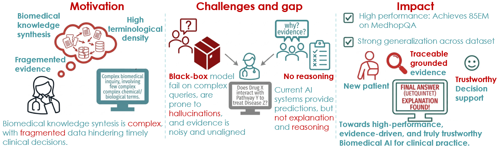
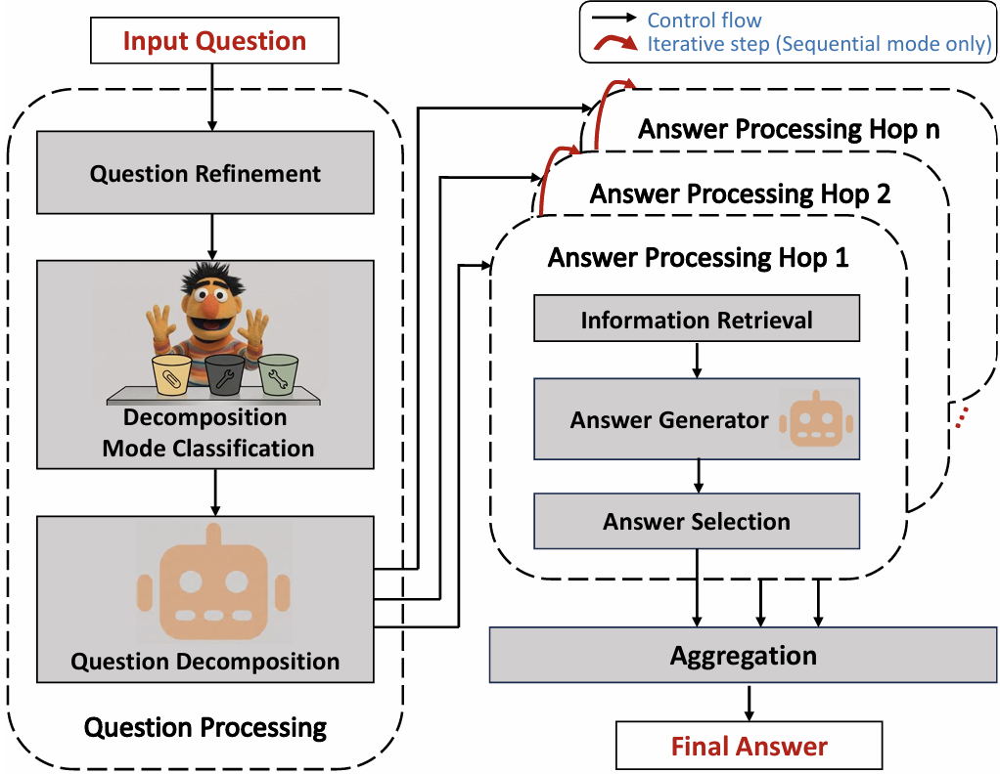
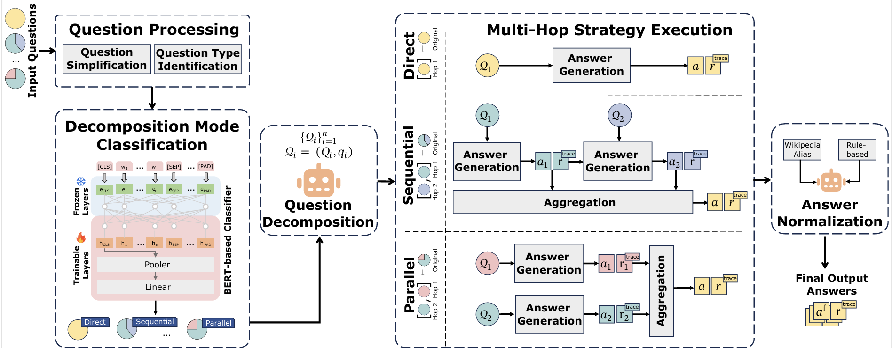
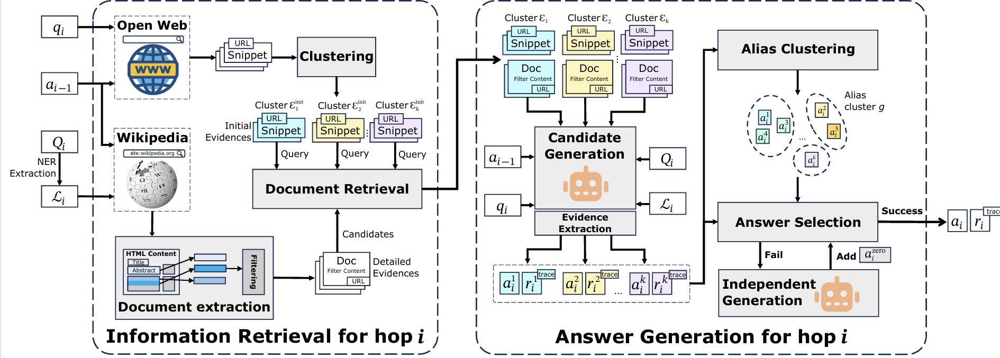

# UETQuintet

UETQuintet is a biomedical question answering system designed to produce accurate, traceable answers while reducing noise through selective decomposition, multi-source retrieval, evidence clustering, and evidence-aware answer generation.

## Abstract

Biomedical QA requires accurate answers from specialized knowledge that is often fragmented and spread across multiple sources. Based on this setting, UETQuintet classifies questions into three reasoning modes: direct, sequential, and parallel, avoiding unnecessary decomposition while still supporting multi-step reasoning when needed. The system retrieves evidence from the open web and Wikipedia, then organizes it through clustering to reduce noise and support reasoning over multiple evidence groups. At the answer generation stage, the model produces answers with explanations and source URLs, making the output traceable. Experiments on MedHopQA and 2WikiMultiHopQA show that the system achieves competitive performance while providing cited explanations that improve inspectability.

## Motivation



## Method

### 1. Overview



### 2. Question Processing



### 3. Answer Processing



Main pipeline:

- Classify questions into direct, sequential, and parallel modes.
- Decompose only when multi-hop reasoning is necessary.
- Retrieve evidence from the web and Wikipedia.
- Cluster evidence to reduce noise.
- Generate answers with explanations and source references.

## Run

1. Edit `config/config.yaml` to choose the dataset and data split.
2. Open `main.py` and adjust the run settings in the `__main__` block if needed, especially `KB` and `threads`.
3. Run the main script:

```bash
python main.py
```

The script reads the selected dataset and configuration from `config/config.yaml` and saves outputs to the corresponding result and cache folders.

## Result

- Competitive results on MedHopQA and 2WikiMultiHopQA.
- Exact Match (EM) reaches 85.0 on MedHopQA and 83.7 on 2WikiMultiHopQA.
- Ablation results show that detailed evidence retrieval contributes the most, followed by evidence clustering and selective decomposition.
- Outputs include explanations and source URLs, making evidence verification easier than with answer-only generation.
- Performance still depends heavily on retrieval quality; results may drop when evidence is sparse, noisy, or missing.

## Publications

- [Pub 1] Nguyen, Quoc An, Vu, Thi Minh Thu, Nguyen, Bich Dat, Tran, Dinh Quang Minh, and Le, Hoang Quynh. “UETQuintet at BioCreative IX–MedHopQA: Enhancing Biomedical QA with Selective Multi-hop Reasoning and Contextual Retrieval.” In Proceedings of the BioCreative IX Challenge and Workshop (BC9), International Joint Conference on Artificial Intelligence (IJCAI), 2025.
- [Pub 2] Nguyen, Quoc An, Vu, Thi Minh Thu, Nguyen, Bich Dat, Tran, Dinh Quang Minh, and Le, Hoang Quynh. “Achieving Reliable Biomedical QA through Selective Multi-hop Reasoning and Contextual Evidence Retrieval.” Under revision at Database, The Journal of Biological Database and Curation, 2026.
- [Pub 3] Vu, Thi Minh Thu, Nguyen, Quoc An, Nguyen, Bich Dat, Tran, Dinh Quang Minh, and Le, Hoang Quynh. “HERF: Hybrid Evidence Retrieval Framework for Entity-Centric Question Answering.” In International Symposium on Information and Communication Technology (SOICT), 2025.
- [Pub 4] Nguyen, Quoc An, Le, Xuan Hung, Vu, Thi Minh Thu, and Le, Hoang Quynh.
“Beyond the Scientific Document: A Citation-Aware Multi-Granular Summa
rization Approach with Heterogeneous Graphs.” In Findings of the Association
for Computational Linguistics: EMNLP 2025, pp. 5034–5046.
- [Pub 5] Nguyen, Quoc An, Le, Xuan Hung, Vu, Thi Minh Thu, and Le, Hoang Quynh.
“CiteArXiv: A Citation-enriched Dataset and Heterogeneous Graph-based
Model for Scientific Articles Summarization.” In Companion Proceedings of
the ACM on Web Conference 2025, pp. 3084–3087.